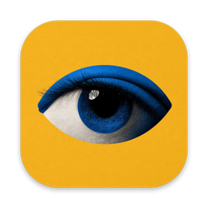

<p align="center"></p>

<h1 align="center">Wink for Mac</h1>

<p align="center">A private web browser for Mac, where AI agents work in plain sight.</p>

<p align="center"><a href="https://github.com/wink-browser/releases/releases/latest/download/Wink.dmg"><b>Download Wink for Mac</b></a><br>macOS 14 or later · Apple silicon</p>

---

This repository only holds Wink's release downloads; it has no source code. [Releases](https://github.com/wink-browser/releases/releases) lists every version with its notes.

**Verify a download.** Every build is signed with a Developer ID and notarized by Apple. Each release lists `Wink.dmg`'s SHA-256 in `Wink.dmg.sha256`.

```sh
shasum -a 256 -c Wink.dmg.sha256        # Wink.dmg: OK
spctl -a -vv /Applications/Wink.app     # accepted, source=Notarized Developer ID
```

**Website:** https://wink.minnebo.ai
